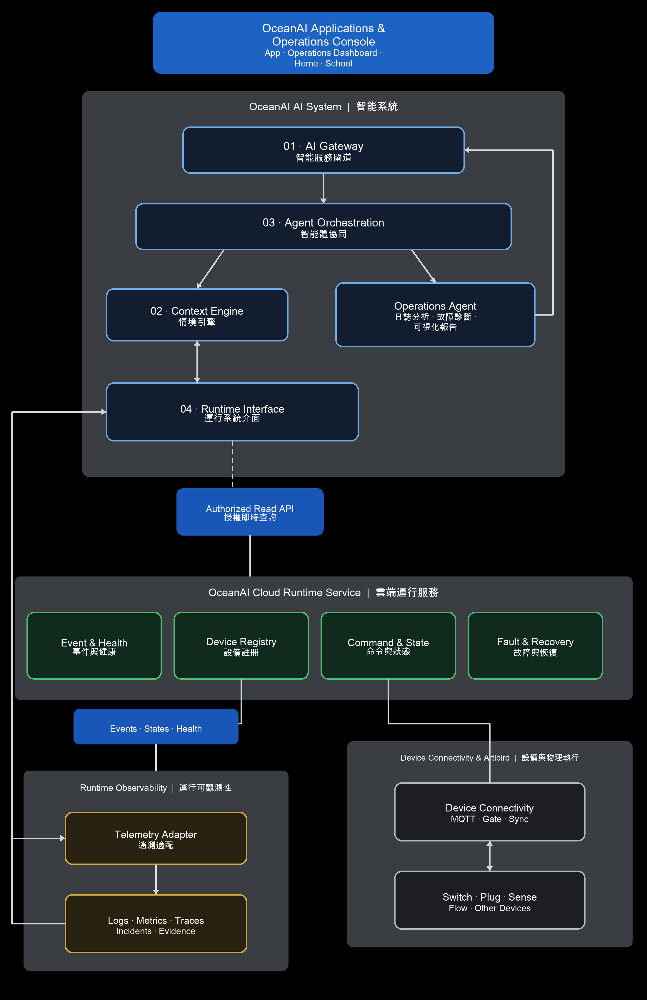
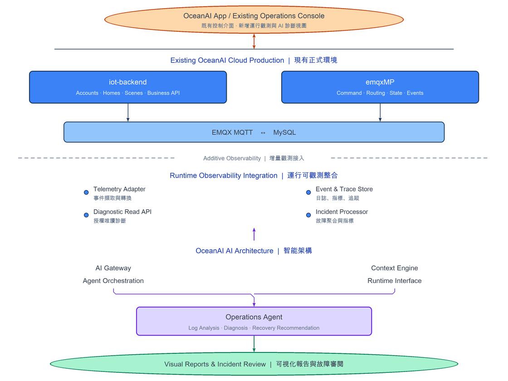

# OAI-AI-ARCH-001 — OceanAI AI Architecture Specification

 

**OceanAI 智能系統架構規格書**

 

Version｜版本：v0.2

 

Date｜日期：2026-11-19

 

Status｜狀態：Architecture Draft｜架構草案

 

Initial Deployment｜初期部署：OceanAI Cloud Mode｜雲端模式

 

Approval｜批准：Author Review Required｜須經負責人審閱

 

---

 

## 1. Executive Architecture｜總體架構

 

OceanAI AI 是 OceanAI 系統級智能空間架構中的智能服務與協同系統，透過共用 Runtime 資料契約，為家庭、學校及其他物理空間提供情境理解、運行分析、故障診斷、任務協同和智能決策能力。

 

### 1.1 Four Core Modules｜四個核心模組

 

正式確立以下四個核心模組：

 

**01 — AI Gateway｜智能服務閘道**

 

請求接入、模型路由、安全驗證、資源限制與結果交付。

 

**02 — Context Engine｜情境引擎**

 

運行資料查詢、證據關聯、時序分析、資料品質檢查及情境組裝。

 

**03 — Agent Orchestration｜智能體協同**

 

任務調度、Agent 協作、工具執行、診斷流程及報告生成。

 

**04 — Runtime Interface｜運行系統介面**

 

Runtime 資料契約、權限控制、事件與狀態查詢、診斷資料接入。

 

### 1.2 Executive Architecture Diagram｜總體架構圖

 

 

**Figure 1 — OceanAI AI Executive Architecture｜OceanAI 智能系統總體架構**

 

本圖表示邏輯能力、主要資料流與系統責任邊界，不規定每個模組必須部署成獨立微服務。

 

### 1.3 Architecture Layers｜架構層次

 

**Layer 1 — OceanAI Applications & Operations Console｜應用與運維控制台**

 

App、Operations Dashboard、Home、School 等應用透過受保護的服務入口使用 AI 能力。

 

**Layer 2 — OceanAI AI System｜智能系統**

 

四個核心模組協同提供請求處理、情境理解、Agent 任務執行與 Runtime 資料存取。

 

**Layer 3 — Runtime Observability｜運行可觀測性**

 

收集並管理 Logs、Metrics、Traces、Incidents 和 Evidence，提供可信、可追溯的診斷資料。

 

**Layer 4 — OceanAI Cloud Runtime Service｜雲端運行服務**

 

負責設備註冊、命令與狀態、事件與健康、故障與恢復，維持運行事實及控制權威。

 

**Layer 5 — Device Connectivity & Artibird｜設備連接與實體設備**

 

提供設備通訊、感測、同步及物理執行能力。

 

### 1.4 Core Module Responsibility Matrix｜核心模組責任矩陣

 

| Module｜模組 | Core Responsibility｜核心責任 | Excluded Responsibility｜不應承擔 |
| --- | --- | --- |
| **AI Gateway** | 統一 AI 請求、模型接入、安全與路由 | 直接操作設備 |
| **Context Engine** | 將 Runtime 資料轉換為可追溯的分析情境 | 成為設備狀態權威 |
| **Agent Orchestration** | 調度診斷、分析、報告等工作 | 繞過授權自主恢復 |
| **Runtime Interface** | 統一 AI 與 Runtime 的資料及操作契約 | 複製 Runtime 控制引擎 |

 

### 1.5 Foundational Principle｜基礎架構原則

 

**AI interprets. Runtime governs. Both operate through explicit contracts.**

 

**AI 分析與推理；Runtime 管控運行；兩者透過明確的資料契約協同。**

 

Runtime 負責系統持續運行、設備狀態、命令執行與安全恢復。

 

AI 負責運行理解、證據分析、診斷推理、決策建議和報告。

 

所有具有實際運行副作用的操作都必須經 Runtime 的授權、策略驗證及執行機制處理。

 

### 1.6 First Business Implementation｜第一個業務實現

 

初期以 **Operations Agent｜運行智能體** 為第一個正式 AI 業務應用，優先完成：

 

1. Runtime Log Analysis｜Runtime 運行日誌分析。
2. Health & Fault Trend Analysis｜健康與故障趨勢分析。
3. Evidence-Based Diagnosis｜證據驅動的故障診斷。
4. Recovery Recommendation｜恢復建議。
5. Visual Report Generation｜可視化報告生成。

 

第一階段採用 Cloud Runtime Mode｜雲端 Runtime 模式。

 

Natural Language Control｜自然語言控制、Space Agent｜空間智能體及其他業務智能體保留為後續擴展能力，不提前納入首階段驗收。

 

---

 

## 2. AI Gateway｜智能服務閘道

 

AI Gateway 為 OceanAI AI 的統一服務入口。

 

### 2.1 Responsibilities｜主要責任

 

- Request Authentication｜請求身分驗證
- Authorization Context｜授權上下文
- Model Routing｜模型路由
- Request Validation｜請求驗證
- Rate & Budget Control｜速率與成本控制
- Structured Output Validation｜結構化輸出驗證
- Request Auditing｜請求稽核
- Safe Error Handling｜安全錯誤處理

 

### 2.2 Task API｜任務介面

 

`POST /api/v1/ai/tasks`

 

輸入採用版本化 `AITaskRequest`，包括：

 

`schema_version`、`request_id`、`task_type`、`scope`、`parameters`、`idempotency_key`。

 

回應使用 `AITaskResponse`：

 

`task_id`、`status`、`accepted_at`、`result_reference`、`error`。

 

任務狀態包括：

 

`QUEUED → RUNNING → COMPLETED`

 

異常終態為 `FAILED`、`CANCELLED` 或 `EXPIRED`。

 

實際使用者身分由已驗證的服務身分或登入憑證取得，不直接信任請求中的自述使用者資訊。

 

---

 

## 3. Context Engine｜情境引擎

 

Context Engine 將 Runtime 運行資料組織為可信、可追溯的 AI 分析上下文。

 

### 3.1 Responsibilities｜主要責任

 

- Runtime Context Retrieval｜運行情境檢索
- Log & Trace Correlation｜日誌與追蹤關聯
- Health Snapshot Assembly｜健康快照組裝
- Incident Context Building｜故障情境組裝
- Evidence Selection｜證據選取
- Temporal Context｜時間關係處理
- Data Quality Assessment｜資料品質評估
- Context Compression｜上下文壓縮

 

### 3.2 Primary Data Contract｜主要資料契約

 

`DiagnosticContext`

 

必要欄位：

 

- `schema_version`
- `context_id`
- `incident_id`
- `scope`
- `time_window`
- `health_snapshot`
- `related_traces`
- `evidence`
- `data_quality`
- `generated_at`

 

Context Engine 必須區分 `FRESH`、`STALE`、`PARTIAL`、`MISSING` 等資料品質情況，並保留來源事件 ID 及時間品質資訊。

 

對缺失的事件不得推斷為沒有發生；對沒有充分關聯證據的命令不得宣稱完成完整追蹤。

 

---

 

## 4. Agent Orchestration｜智能體協同

 

Agent Orchestration 負責 AI 工作流程、任務調度、工具調用、診斷結果管理與審閱。

 

### 4.1 Initial Agent｜首階段智能體

 

**Operations Agent｜運行智能體**

 

內部可按四個邏輯職責組織：

 

- Operations Manager｜運維管理者
- Log Analyst｜日誌分析員
- Diagnostic Agent｜診斷員
- Recovery Planner｜恢復規劃員

 

MVP 階段可以由一個 Agent Service 承載，不強制拆分為四個獨立模型。

 

### 4.2 Workflow｜工作流程

 

Receive Task → Build Context → Run Deterministic Checks → Analyze Evidence → Form Hypotheses → Validate Findings → Generate Report

 

接收任務 → 建立情境 → 執行確定性檢查 → 分析證據 → 形成根因假設 → 驗證結論 → 生成報告。

 

### 4.3 Tool Permissions｜工具權限

 

允許：

 

- `get_runtime_health`
- `get_incident`
- `get_trace`
- `search_runtime_events`
- `get_device_state_history`
- `get_recovery_history`
- `create_diagnostic_report`

 

禁止：

 

- `execute_device_command`
- `restart_runtime_service`
- `modify_device_configuration`
- `trigger_ota_update`
- `execute_recovery_action`

 

### 4.4 Diagnosis Contract｜診斷契約

 

`DiagnosisResult` 應包含：

 

`diagnosis_id`、`context_id`、`status`、`observations`、`hypotheses`、`missing_evidence`、`recommendations`、`model_provenance`、`evidence_references`。

 

診斷必須將觀測事實、根因假設與恢復建議分離，不得將模型猜測寫成已證實結論。

 

---

 

## 5. Runtime Interface｜運行系統介面

 

Runtime Interface 是 OceanAI AI 與 ORT Cloud Runtime、後續 ART Hub Runtime 之間的共用資料契約邊界。

 

### 5.1 Responsibilities｜主要責任

 

- Runtime Read API｜運行唯讀查詢
- Telemetry Adapter｜遙測適配
- Event Subscription｜事件訂閱
- Context Authorization｜情境授權
- Device State Retrieval｜設備狀態查詢
- Trace Retrieval｜運行追蹤查詢
- Recovery Proposal Submission｜恢復建議提交

 

### 5.2 Cloud Mode Integration｜雲端模式整合

 

Cloud Runtime
→ Telemetry Adapter
→ Observability Store
→ Runtime Interface
→ Context Engine
→ Operations Agent

 

Runtime Interface 可根據授權向 Cloud Runtime 查詢最新狀態。

 

### 5.3 Diagnostic Read API｜診斷唯讀介面

 

候選 API：

 

| Method | Endpoint | Purpose｜用途 |
| --- | --- | --- |
| GET | `/internal/v1/runtime/health` | 運行健康 |
| GET | `/internal/v1/runtime/events` | 事件查詢 |
| GET | `/internal/v1/runtime/traces/{id}` | 命令追蹤 |
| GET | `/internal/v1/runtime/incidents/{id}/evidence` | 故障證據 |
| GET | `/internal/v1/runtime/devices/{id}/state-history` | 設備狀態歷史 |
| GET | `/internal/v1/runtime/recovery-history` | 恢復歷史 |

 

以上為候選介面，實作前必須與現有 Cloud Runtime API 核對。

 

### 5.4 Recovery Boundary｜恢復權限邊界

 

首階段 Operations Agent 可以提交建議供人工審閱，但不得直接執行具有設備或系統副作用的恢復操作。

 

未來需要恢復執行時，必須經獨立人工審批及 Runtime 再次驗證，並具備審批憑證、執行期限、結果回報與完整稽核紀錄。

 

---

 

## 6. Shared Data Contracts｜共用資料契約

 

四個模組採用版本化資料契約：

 

| Contract｜契約 | Producer｜產生端 | Consumer｜使用端 |
| --- | --- | --- |
| `AITaskRequest` | Applications / AI Gateway | Agent Orchestration |
| `DiagnosticContext` | Context Engine | Operations Agent |
| `RuntimeEvent` | Runtime / Telemetry Adapter | Observability Store |
| `HealthSnapshot` | Runtime Observability | Context Engine / Dashboard |
| `RuntimeTrace` | Runtime Observability | Context Engine |
| `Incident` | Incident Processor | Agent Orchestration |
| `DiagnosisResult` | Operations Agent | Reports / Console |
| `RecoveryProposal` | Operations Agent | Human Review Workflow |

 

契約必須保留時間、來源、權限及證據關聯。

 

不得讓 AI 的推測結果覆寫 Runtime 的設備狀態。

 

---

 

## 7. Security & Reliability｜安全與可靠性

 

架構必須遵循：

 

1. Least Privilege｜最小權限
2. Tenant Isolation｜租戶隔離
3. Evidence Traceability｜證據可追溯
4. Failure Isolation｜故障隔離
5. Structured Output Validation｜結構化輸出驗證
6. Sensitive Data Minimization｜敏感資料最小化
7. Prompt Injection Isolation｜提示注入隔離
8. Auditability｜可稽核性

 

原始日誌屬於不可信輸入資料，不得據此改變 Agent 的工具權限或系統指令。

 

AI 服務停止或異常時，Cloud Runtime 的核心控制流程必須維持可用。

 

---

 

## 8. Production Compatibility｜正式環境相容

 

 

**Figure 2 — Existing Production and Additive Integration｜現有正式環境與增量整合**

 

本圖表示現有正式環境、增量觀測、智能架構與可視化報告的關係。圖中的 iot-backend、emqxMP、EMQX MQTT 與 MySQL 依原圖保留。

 

第一階段必須保留現有：

 

- OceanAI Cloud Runtime 核心控制流程
- iot-backend 業務 API
- emqxMP 訊息處理
- EMQX MQTT Topic 與歷史 payload 欄位
- MySQL 既有資料語意
- IOTControl 現行 App 行為
- Home / School Domain 業務結構
- 現行 Production 部署方式

 

優先以增量觀測接入與獨立 AI 服務實現功能，不要求改動既有設備韌體。

 

對現有系統能力的判斷，必須以原始程式與運行證據為準。

 

---

 

## 9. MVP Implementation｜MVP 實施順序

 

**P0 — Current System Assessment｜現有系統審查**

 

檢查真實 Cloud Runtime、日誌、事件、命令資料、API 及部署。

 

**P1 — Runtime Interface｜運行介面**

 

建立受控唯讀資料介面、Telemetry Adapter 與版本化 Schema。

 

**P2 — Context Engine｜情境引擎**

 

完成故障情境組裝、時間關聯、證據引用和資料品質控制。

 

**P3 — AI Gateway & Agent Orchestration｜AI 閘道與智能體協同**

 

完成模型路由、受限工具、Operations Agent 與結構化診斷。

 

**P4 — Visual Report Integration｜可視化報告整合**

 

整合既有 Operations Console，呈現日誌分析、健康趨勢、故障診斷及恢復建議。

 

**P5 — Reliability & Acceptance｜可靠性與驗收**

 

執行契約測試、授權測試、故障注入、性能回歸與生產相容性驗證。

 

每階段提交 `REVIEW.md`，記錄完成度、品質、測試證據、風險及改進事項。

 

---

 

## 10. Acceptance Criteria｜驗收標準

 

| ID | Acceptance｜驗收項目 |
| --- | --- |
| ARC-01 | 四個核心模組責任及 API 邊界清晰 |
| ARC-02 | Operations Agent 可透過 Runtime Interface 查詢真實運行資料 |
| ARC-03 | Context Engine 可組裝可追溯的故障證據 |
| ARC-04 | AI Gateway 具備身分驗證、模型路由與結果驗證 |
| ARC-05 | Agent 的診斷結論能區分事實和假設 |
| ARC-06 | AI 無法繞過 Runtime 執行設備控制 |
| ARC-07 | Runtime Observability 故障不阻塞正常設備控制 |
| ARC-08 | 既有 Cloud Production API、MQTT 協議和 App 行為保持相容 |
| ARC-09 | 可生成實際 Runtime 健康、故障及 AI 診斷報告 |
| ARC-10 | 所有端到端驗收具有可追溯的測試證據 |

 

---

 

## 11. Architectural Conclusion｜架構結論

 

**One AI Architecture. Shared Runtime Contracts. Domain-Specific Agents.**

 

**統一 AI 架構，共用 Runtime 契約，依業務領域部署智能體。**

 

OceanAI AI 建立四個穩定核心：

 

AI Gateway、Context Engine、Agent Orchestration、Runtime Interface。

 

Operations Agent 是第一個正式業務實現，使用 Cloud Runtime 的可信運行資料，提供健康分析、故障診斷、恢復建議及可視化報告。

 

後續增加 Space Agent、Interaction Agent 或其他場域智能體時，應沿用相同的基礎架構與權限邊界。

 

本版本形成架構審閱基準；實際模組與現有程式碼的對應、部署成本、性能及診斷準確性仍需工程驗證。

 

---

 

End of Specification｜規格結束

 

**OAI-AI-ARCH-001 · v0.2 · Author Review Required**
