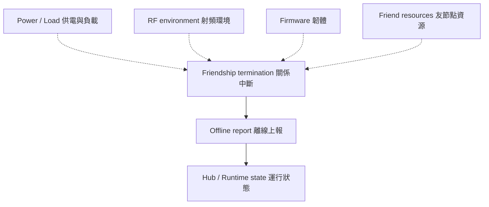
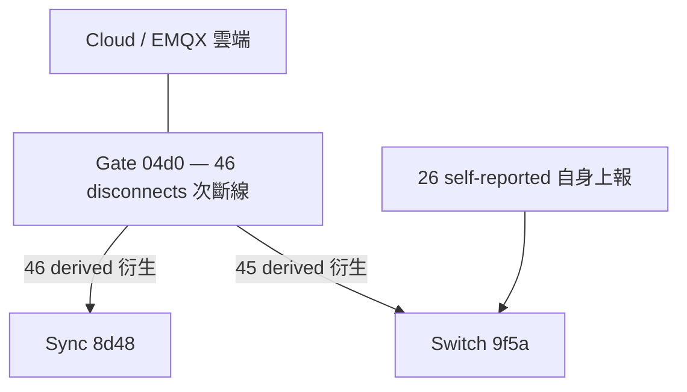
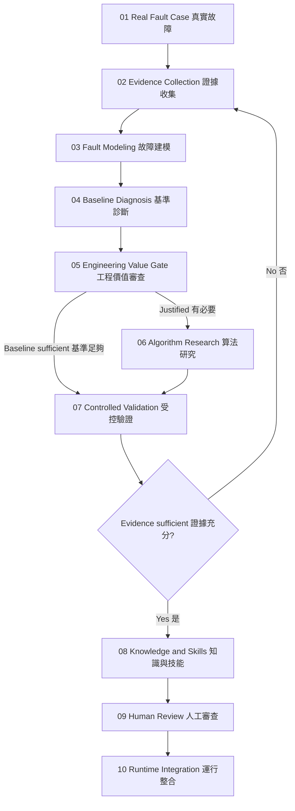
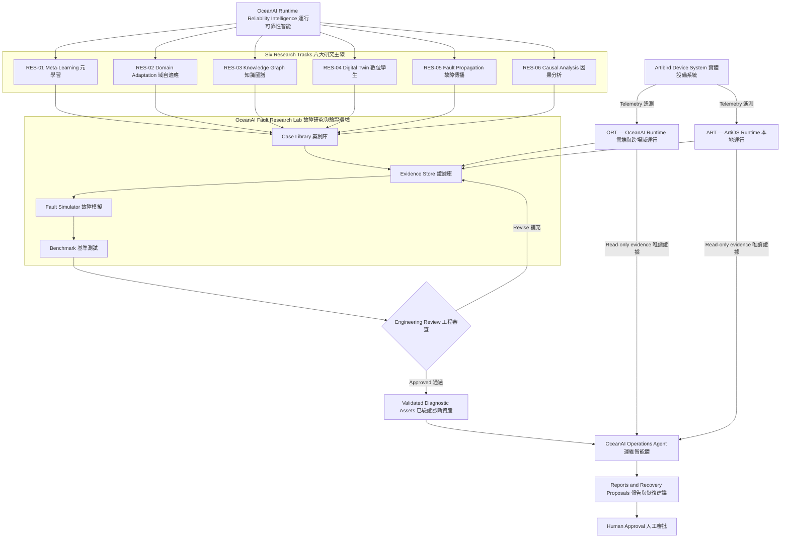

# OAI-RES-001 v0.1 — Runtime Reliability Intelligence
# OceanAI 運行可靠性智能研究計劃

| Metadata｜文件資訊 | Value｜內容 |
|---|---|
| Document ID｜文件編號 | OAI-RES-001 |
| Version｜版本 | v0.1 |
| Status｜狀態 | Proposed Research Baseline｜建議研究基準，待審閱 |
| Scope｜研究對象 | OceanAI Runtime (ORT) / ArtiOS Runtime (ART) / Artibird |
| Engineering Integration｜工程承接 | OceanAI Operations Agent |
| Research Boundary｜研究邊界 | Research Only｜研究限定；不直接修改生產環境 |

> **Keep Running. Act as One.**  
> **持續運行，協同如一。**

## 1. Research Objective｜研究目標

Develop evidence-driven intelligence that enables distributed physical systems to understand their operational conditions, identify faults, explain causes, anticipate risks, and support reliable recovery.

發展以證據驅動的智能能力，使分散式物理系統能夠理解自身運行狀況、識別故障、解釋原因、預判風險，並支援可靠恢復。

Adopt the six research tracks as OceanAI research directions. Validate their engineering value using real Artibird fault cases before selecting specific algorithms and open-source tools.

將六個方向納入 OceanAI 研究體系，優先利用 Artibird 真實故障案例驗證工程價值，再決定具體算法與開源工具選型。

## 2. Research Principles｜研究原則

| Principle｜原則 | Requirement｜要求 |
|---|---|
| Problem-Driven｜問題驅動 | Start with real faults.｜以真實工程故障為起點。 |
| Evidence-Driven｜證據驅動 | Make conclusions traceable.｜診斷結論須具備可追溯證據。 |
| Validation First｜驗證優先 | Validate value before selecting tools.｜先驗證價值，再選型。 |
| Progressive Intelligence｜漸進式智能 | Progress from rules and statistics to learning when justified.｜從規則、統計、拓撲分析逐步引入學習算法。 |
| Knowledge Accumulation｜知識積累 | Preserve validated cases and reusable skills.｜保存已驗證案例與可重用 Skills。 |
| Human Governance｜人工治理 | Retain human review and approval.｜保留人工覆核、修復決策及安全審批。 |

## 3. Six Research Tracks｜六大研究主線

| ID | Research Track｜研究主線 | Research Question｜研究問題 | Expected Output｜預期成果 | Priority｜優先級 |
|---|---|---|---|---|
| RES-01 | Few-/Zero-Shot Meta-Learning｜小樣本／零樣本元學習 | Can limited verified cases help diagnose new devices?｜如何利用少量已確認案例協助診斷新設備？ | Few-shot diagnostic capability｜小樣本診斷能力 | P2 |
| RES-02 | Cross-Domain Fault Diagnosis｜跨設備／跨工況診斷 | Can knowledge transfer across devices and sites?｜診斷知識如何跨設備、跨場域遷移？ | Transferable diagnostic knowledge｜可遷移診斷知識 | P2 |
| RES-03 | Knowledge Graph & Evidence Fusion｜知識圖譜與證據融合 | How can heterogeneous evidence be linked?｜如何融合日誌、程式碼、韌體、硬體及人工證據？ | Runtime Knowledge Graph｜運行知識圖譜 | P0 |
| RES-04 | Digital Twin & Fault Simulation｜數位孿生與故障模擬 | How can faults be reproduced safely?｜如何安全復現及驗證故障？ | Runtime Fault Simulator｜運行故障模擬器 | P1 |
| RES-05 | System-Level Fault Propagation｜系統級故障傳播 | Where does a fault originate and what does it affect?｜故障源頭、傳播路徑及影響範圍為何？ | Fault Propagation Engine｜故障傳播引擎 | P0 |
| RES-06 | Causal Root Cause Analysis｜因果根因分析 | How can candidate causes be tested?｜如何形成並驗證根因假設？ | Causal Diagnosis Engine｜因果診斷引擎 | P0 |

P0 denotes priority research and foundational validation, not immediate implementation of advanced models.  
P0 代表優先研究及基礎驗證，不代表立即開發進階模型。

## 4. Real-World Research Cases｜真實研究案例

### 4.1 OAI-FAULT-CASE-001 — Single-Live Switch Flapping｜單火開關反覆離線

**Site｜場域：** 鴻觀寰宇／總經辦／主燈 dbfc。

| Evidence Item｜證據項 | Reported Observation｜已提供的觀測摘要 |
|---|---|
| Offline events｜離線次數 | 454 |
| Median duration｜時長中位數 | 6.8 s |
| Concentration｜集中時段 | 11-18 至 11-20：439 次；11-21 後每天 2–8 次 |
| Off-hours｜非工作時段 | 219 次 |
| Hub-reported｜Hub 上報 | 437 次 |
| Gateway-derived｜網關衍生 | 17 次 |
| Firmware behavior｜韌體行為 | 按提供的程式碼對照摘要，Friendship 中斷報離線，重建報在線 |
| Root cause｜根因 | UNKNOWN｜未知 |

Research questions｜研究問題：

- Why does Friendship repeatedly terminate?｜Friendship 為何反覆中斷？
- Are power, load, RF, firmware or Friend resources involved?｜供電、負載、射頻、韌體或 Friend 資源是否相關？
- What changed around November 21?｜11 月 21 日前後發生了什麼變化？

Tracks｜對應研究：RES-03、RES-04、RES-06。



Dashed edges represent hypotheses; solid edges represent the reported firmware mechanism, not independently verified raw events.  
虛線為候選因果假設；實線表示已提供的韌體機制摘要，尚未獨立核對逐筆原始事件。

### 4.2 OAI-FAULT-CASE-002 — Gateway Disconnection & Propagation｜網關斷線與衍生離線

**Site｜場域：** 日月光／客廳／Gate A01 04d0。

| Evidence Item｜證據項 | Reported Observation｜已提供的觀測摘要 |
|---|---|
| Gate disconnections｜網關斷線 | 46 次，跨度六天多 |
| Recovery concentration｜恢復時長集中 | 40 次在 17–20 秒內恢復 |
| Peak days｜高峰日期 | 11-22：11 次；11-23：12 次 |
| Off-hours｜非工作時段 | 42 次 |
| Sync 8d48 | 46 次離線，全部為網關衍生 |
| Switch 9f5a | 71 次離線：45 次衍生、26 次自身上報 |
| Missing evidence｜缺失證據 | EMQX 斷開原因尚未保存（Issue #44） |
| Root cause｜根因 | UNKNOWN｜未知 |



The graph shows reported status propagation, not proof of physical device failure.  
此圖表示已提供的狀態傳播關係，不代表下游設備實際物理功能失效。

原始統計共 163 次離線事件；排除 91 次已識別的衍生事件後，保留 72 次待分析事件。72 次不等同於 72 個獨立根因。

Research questions｜研究問題：MQTT／Wi-Fi／韌體何處先失效？17–20 秒是否與超時或重連策略有關？如何自動識別衍生離線並區分通訊可達性與實際工作狀態？

Tracks｜對應研究：RES-03、RES-05、RES-06。

## 5. Research Methodology｜研究方法



先以規則、統計、拓撲及工程分析建立基準；確認其不足與進階研究的工程價值後，才進行算法比較。受控實驗須隔離於生產環境；證據不足時保留 UNKNOWN。

## 6. Engineering Architecture｜研究與工程架構



The diagram represents a proposed logical research architecture; actual ORT/ART deployment and device connectivity depend on the site configuration.  
此圖為建議的邏輯研究架構，實際 ORT／ART 部署與設備連接依場域配置而定。研究及診斷流程沒有自動下發控制或修復的路徑。

### 6.1 Plain-Text Architecture｜純文字架構（無 Mermaid 亦可閱讀）

```text
OceanAI — Runtime Reliability Intelligence
OceanAI — 運行可靠性智能
│
├── Six Research Tracks｜六大研究主線
│   ├── RES-01 Meta-Learning｜元學習
│   ├── RES-02 Domain Adaptation｜域自適應
│   ├── RES-03 Knowledge Graph｜知識圖譜
│   ├── RES-04 Digital Twin｜數位孿生
│   ├── RES-05 Fault Propagation｜故障傳播
│   └── RES-06 Causal Analysis｜因果分析
│                         │
│                         ▼
├── Fault Research Lab｜故障研究實驗環境
│   Case Library / Evidence Store｜案例庫／證據庫
│   Fault Simulator / Benchmark｜模擬／基準測試
│                         │
│                         ▼
├── Engineering Review｜工程審查
│                         │ Approved｜通過
│                         ▼
├── Validated Diagnostic Assets｜已驗證診斷資產
│   Rules / Skills / Models / Knowledge｜規則／技能／模型／知識
│                         │
│                         ▼
└── OceanAI Operations Agent｜運維智能體
    │       ▲                    ▲
    │       │ Read-only｜唯讀    │
    │   ORT｜雲端運行        ART｜本地運行
    │       ▲                    ▲
    │       └─────────┬──────────┘
    │         Artibird Device System
    │         Artibird 實體設備系統
    ▼
    Reports / Recovery Proposals｜報告／恢復建議
    Human Approval｜人工審批
```

### 6.2 Evidence Model｜證據模型

| Entity｜實體 | Purpose｜用途 |
|---|---|
| Device / Topology｜設備／拓撲 | Identify dependencies｜識別依賴關係 |
| Event / Timestamp｜事件／時間 | Reconstruct timelines｜重建事件時間線 |
| Firmware / Source Code｜韌體／原始碼 | Link behavior to exact versions｜關聯行為與確切版本 |
| Hypothesis / Evidence｜假設／證據 | Preserve supporting and opposing evidence｜保存支持及反對證據 |
| Experiment / Validation｜實驗／驗證 | Record interventions and outcomes｜記錄干預及結果 |
| Case / Skill｜案例／技能 | Reuse reviewed knowledge｜重用經審查的知識 |

## 7. Algorithm Selection Policy｜算法選型政策

No specific algorithm or open-source framework is locked at this stage.｜本階段不鎖定具體算法或開源框架。

| Track｜主線 | Baseline｜基準方法 | Advanced Candidates｜進階候選 |
|---|---|---|
| RES-01 | Case retrieval / similarity｜案例檢索／相似度 | MAML / Prototypical Networks｜元學習／原型網路 |
| RES-02 | Feature normalization / rule transfer｜特徵標準化／規則遷移 | DANN / Transfer Learning｜域對抗／遷移學習 |
| RES-03 | Structured evidence / relationship graph｜結構化證據／關係圖 | GAT / Graph Reasoning｜圖注意力／圖推理 |
| RES-04 | Event replay / fault injection｜事件重放／故障注入 | Hybrid Digital Twin｜混合數位孿生 |
| RES-05 | Topology traversal / temporal correlation｜拓撲遍歷／時間關聯 | GNN / ST-GCN｜圖神經網路／時空圖卷積 |
| RES-06 | Fault tree / controlled experiments｜故障樹／受控實驗 | SCM / Temporal Causal Discovery｜結構因果模型／時序因果發現 |

Selection gate｜選型門檻：與基準方法比較，評估準確性、誤報、證據可追溯性、維護成本、安全性及部署約束。具體開源工具須另行核實授權、版本及可重現性。零樣本及反事實推理不應被視為已證明的根因診斷能力。

## 8. Research Evaluation｜研究成果評估

| Metric｜指標 | Evaluation｜評估 |
|---|---|
| Diagnostic Accuracy｜診斷準確率 | Compare against reviewed labels｜對照覆核標籤 |
| Root Cause Accuracy｜根因準確率 | Use confirmed cases only｜以已確認根因為基準 |
| False Positive Rate｜誤報率 | Evaluate normal and abnormal events｜評估正常及異常事件 |
| Evidence Traceability｜證據可追溯性 | Trace conclusions to source records｜結論可追溯至原始紀錄 |
| Unknown Handling｜未知故障處理 | Retain uncertainty without forced labels｜保留不確定性，不強制分類 |
| Cross-Device Generalization｜跨設備泛化 | Hold out devices or sites｜保留未見設備或場域測試 |
| Diagnostic Latency｜診斷耗時 | Measure end-to-end time｜量測端到端耗時 |
| Engineering Cost｜工程成本 | Assess implementation and maintenance｜評估實施及維護 |
| Knowledge Reusability｜知識重用 | Test reviewed skills on new cases｜以新案例驗證技能 |
| Safety & Reliability｜安全與可靠性 | Verify permission boundaries｜驗證權限邊界 |

尚未取得足夠標註資料，因此不預設模型準確率承諾。重複離線事件不得直接視為相互獨立的根因訓練樣本。

## 9. Research Repository｜研究儲存庫

Suggested repository, not yet created.｜建議儲存庫結構，尚未實際建立。

```text
oceanai-reliability-research/
├── AGENTS.md
├── README.md
├── research/                 # Research tracks｜研究主線
│   ├── meta-learning/
│   ├── domain-adaptation/
│   ├── knowledge-graph/
│   ├── digital-twin/
│   ├── fault-propagation/
│   └── causal-analysis/
├── cases/                    # Fault cases｜故障案例
├── datasets/                 # Sanitized datasets｜脫敏資料集
├── evidence/                 # Evidence references｜證據索引
├── algorithms/               # Candidate algorithms｜候選算法
├── tools/                    # Open-source research｜開源工具研究
├── experiments/              # Experiments｜實驗
├── benchmarks/               # Benchmarks｜基準測試
├── skills/                   # Validated skills｜已驗證技能
├── reports/                  # Research reports｜研究報告
└── reviews/                  # REVIEW.md｜審查報告
```

生產來源預設唯讀；機密原始日誌不得直接提交至 Git。禁止未經批准修改生產系統、設備韌體及控制策略。

## 10. Research Roadmap｜研究路線圖

| Phase｜階段 | Deliverable｜交付成果 | Exit Gate｜階段驗收 |
|---|---|---|
| 1 Evidence & Baseline｜證據與基準 | 兩個真實案例、證據收集、拓撲關聯、基準診斷 | 可重建時間線；區分衍生與自身上報；保留 UNKNOWN |
| 2 Knowledge & Skills｜知識與技能 | 案例庫、證據關係圖、診斷 Skills | 人工覆核、技能版本與回歸測試 |
| 3 Causality & Simulation｜因果與模擬 | 故障注入、因果假設、受控實驗 | 可重現實驗及明確證據限制 |
| 4 Learning & Prediction｜學習與預測 | GNN、元學習、跨域遷移及預測候選 | 與簡單基準比較，證明增益 |
| 5 Runtime Integration｜運行整合 | 成熟診斷資產接入 Operations Agent、ORT／ART | 安全審查、驗收及人工批准 |

本研究路線獨立於 Operations Agent MVP 工程交付，不改變既有 Phase 1 日誌接入、可視化、診斷及報告；Phase 2 Skill 演進的實施順序。

## 11. First Research Task｜首個研究任務

**OAI-RES-TASK-001 — Evidence-Based Connectivity Fault Diagnosis｜基於證據的連線故障診斷研究**

| Item｜項目 | Requirement｜要求 |
|---|---|
| Devices｜設備 | dbfc、04d0、8d48、9f5a |
| Scope｜範圍 | BLE Mesh、Wi-Fi、MQTT、EMQX、韌體、供電 |
| Sources｜來源 | 運行日誌、原始碼、拓撲、工程測試 |
| Execution｜執行 | Codex、Operations Agent、工程分析工具 |
| Human Role｜人工角色 | 現場取證、硬體量測、復現、結果覆核 |
| Boundaries｜邊界 | 唯讀生產資料；不提前鎖定算法；不自動修復 |
| Deliverables｜交付 | 研究報告、證據鏈、候選根因、實驗方案、REVIEW.md |

### 11.1 Immediate Work Packages｜立即執行工作包

| ID | Task｜任務 | Acceptance｜驗收 |
|---|---|---|
| WP-01 | Collect logs and versions｜收集原始日誌與版本 | 每份資料具來源、時間範圍、版本、缺失說明 |
| WP-02 | Reconstruct timelines｜重建時間線 | 區分設備事件時間與接收時間，註明時鐘偏差 |
| WP-03 | Correlate topology｜拓撲關聯 | 核對 46、91、26 事件統計與原始紀錄；無法核對時明確說明 |
| WP-04 | Assess missing evidence｜評估證據缺口 | 核對 Issue #44 及 EMQX、Wi-Fi、Friendship、Boot ID、Reset Reason 資料缺失 |
| WP-05 | Design controlled experiments｜設計受控實驗 | 提出可證偽假設、對照條件、量測指標；硬體供電測試由合格工程師執行 |
| WP-06 | Produce review｜產出審查 | 事實、假設、UNKNOWN、驗證結果分開呈現；附 REVIEW.md |

## 12. Relationship to OceanAI Architecture｜與 OceanAI 架構理論的關係

| Architecture｜架構 | Research Relationship｜研究關係 |
|---|---|
| Archipelago Architecture｜群島架構 | Fault isolation, dependencies, impact boundaries｜故障隔離、依賴與影響邊界 |
| Liquid Runtime｜流動運行 | Adaptation, recovery, continuity｜動態適應、恢復、持續運行 |
| Spatial Orchestration｜空間協同 | State coordination and propagation｜狀態協同與故障傳播 |
| Runtime Reliability Intelligence｜運行可靠性智能 | Diagnosis, prediction, knowledge evolution｜診斷、預測、知識演進 |

Runtime Reliability Intelligence remains a research and engineering capability, not a fourth architectural pillar.  
運行可靠性智能作為獨立研究與工程能力，維持既有三大架構理論，不新增第四支柱。

## 13. Source and Evidence Boundary｜來源與證據邊界

- Research inspiration｜研究啟發：使用者提供的四張「故障診斷＋人工智能」圖片，包含六項研究構想。
- Case evidence｜案例證據：使用者提供的兩個真實故障案例統計及韌體機制摘要。
- Proposed design｜建議設計：本文件架構、優先級、研究路線及驗收方式來自前述研究計劃及工程整理，待審閱。
- Limitations｜限制：尚無完整原始日誌、原始碼版本、硬體量測或原始研究論文，未獨立確認案例根因、算法成效或工具成熟度；未實際建立儲存庫或修改任何系統。

---

**Turn real faults into research cases, validated diagnoses into knowledge assets, and engineering evidence into the foundation for evolving intelligence.**

**讓每一次真實故障成為研究案例，讓每一次有效診斷成為知識資產，讓每一次工程驗證成為 OceanAI 智能能力演進的基礎。**

## Appendix A — REVIEW.md｜本次文件交付審查

| Review Item｜審查項 | Result｜結果 |
|---|---|
| Summary｜摘要 | 將 OAI-RES-001 v0.1 研究計劃整理為獨立 Markdown，包含六條研究主線、案例、架構及研究任務。 |
| Completeness｜完成度 | 文件已整理完成；研究實驗尚未執行。 |
| Quality｜品質 | 英文術語與繁中對照；Mermaid 與純文字架構並存。 |
| Issues｜問題 | 原始證據與論文未核實；根因保持 UNKNOWN；Mermaid 顯示依閱讀器支援而異。 |
| Deliverable｜成果 | OAI-RES-001-v0.1.md |
| Inheritance & Improvement｜繼承與改進 | 保留既有 MVP 階段順序及研究方向；補充工程價值審查、工作包與證據邊界。 |
