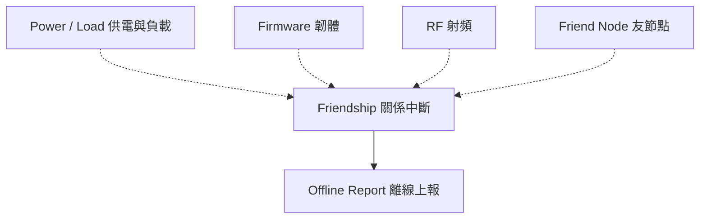
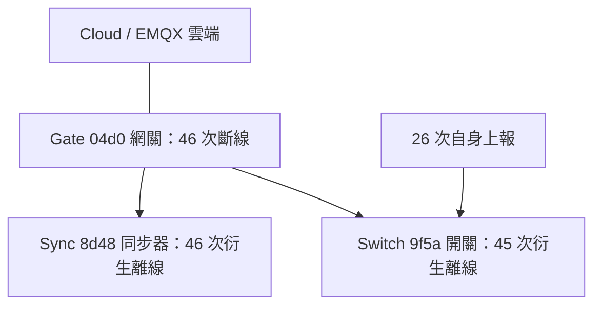
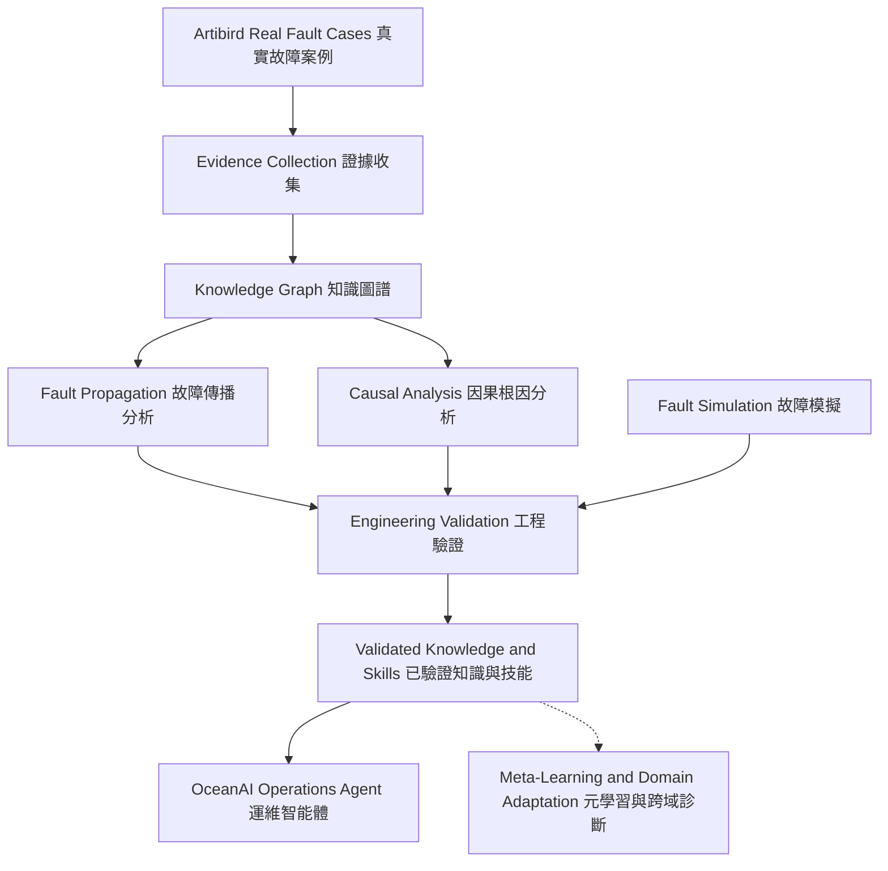

# OAI-RES-001 v0.2 — Runtime Reliability Intelligence
# OceanAI 運行可靠性智能研究計劃

> Research Proposal｜研究提案，待審閱
>
> Keep Running. Act as One.｜持續運行，協同如一。

## 1. Research Objective｜研究目標

Study how intelligent spaces can detect faults, understand their causes, assess their impact, and support reliable recovery.

研究智能空間如何識別故障、理解原因、評估影響，以及支援可靠恢復。

以 Artibird 真實故障為研究起點，先驗證工程價值，再決定具體算法與開源工具。研究成果經過驗證後，逐步應用於 OceanAI Operations Agent。

## 2. Six Research Tracks｜六個研究方向

| 研究方向 | 對 OceanAI 的價值 | 優先順序 |
|---|---|---|
| 01 Meta-Learning｜元學習 | 利用少量已確認的案例，協助診斷新設備與罕見故障 | 後續 |
| 02 Domain Adaptation｜域自適應 | 將家庭、辦公室、校園及不同設備的診斷知識互相遷移 | 後續 |
| 03 Knowledge Graph｜知識圖譜 | 關聯日誌、程式碼、設備拓撲及工程師經驗，建立證據鏈 | 優先 |
| 04 Digital Twin｜數位孿生 | 在測試環境模擬和復現故障，驗證修復方案 | 第二步 |
| 05 Fault Propagation｜故障傳播 | 識別故障來源、傳播路徑及受影響設備，研究系統級風險 | 優先 |
| 06 Causal Analysis｜因果分析 | 研究故障為什麼發生，以及改變某個條件能否消除故障 | 優先 |

現階段優先研究第 3、5、6 項。先用現有日誌、拓撲、規則與工程分析驗證價值，暫不要求訓練圖神經網路或其他模型。

## 3. Real-World Cases｜真實研究案例

### Case 01 — Single-Live Switch｜單火開關反覆離線

鴻觀寰宇／總經辦／主燈 dbfc

- 共離線 454 次，中位時長 6.8 秒。
- 437 次由 Hub 上報，17 次由網關斷線引起。
- 11 月 18–20 日共 439 次；11 月 21 日後降至每天 2–8 次。
- 已提供的韌體分析顯示：與 Friend 節點的連接中斷時報離線，重建時報在線。

**研究問題：** Friend 連接為什麼中斷？是否與供電、負載、韌體、射頻或 Friend 節點有關？11 月 21 日前後發生了什麼變化？



虛線是待驗證假設；實線是已提供的韌體機制。根因仍為 UNKNOWN。

對應研究：知識圖譜、因果分析、故障模擬。

### Case 02 — Gateway｜網關斷線與故障傳播

日月光／客廳／網關 04d0

- 網關斷線 46 次，其中 40 次在 17–20 秒內恢復。
- 同步器 8d48：46 次離線全部由網關斷線引起。
- 零火開關 9f5a：71 次離線中，45 次由網關斷線引起，26 次為自身上報。



**研究問題：** 網關為什麼斷線？為什麼恢復時間集中在 17–20 秒？如何自動識別衍生離線？

目前缺少 EMQX 斷開原因及完整韌體診斷證據，根因仍為 UNKNOWN。下游離線紀錄也不能直接證明設備停止工作。

對應研究：知識圖譜、故障傳播、因果分析。

## 4. Research Architecture｜研究架構



純文字架構圖（不需要 Mermaid 支援）：

```text
Artibird Real Fault Cases｜真實故障案例
                    │
Evidence Collection｜證據收集
                    │
Knowledge Graph｜知識圖譜
          ┌─────────┴─────────┐
  Fault Propagation     Causal Analysis
  故障傳播分析           因果根因分析
          └─────────┬─────────┘
                    │ ← Fault Simulation｜故障模擬
Engineering Validation｜工程驗證
                    │
Validated Knowledge & Skills｜已驗證知識與技能
          ├── OceanAI Operations Agent｜運維智能體
          └── Meta-Learning / Domain Adaptation
              元學習／跨域診斷（後續研究）
```

架構圖表達研究成果如何形成與應用，並非要求立即開發所有模組。

## 5. Research Roadmap｜研究步驟

| 階段 | 實際工作 |
|---|---|
| 1. Evidence & Baseline｜證據與基準 | 收集兩個案例的原始日誌、拓撲、程式碼及韌體資料，建立基準診斷 |
| 2. Knowledge & Skills｜知識與技能 | 建立案例庫、證據關係及經人工驗證的診斷技能 |
| 3. Causality & Simulation｜因果與模擬 | 進行受控實驗、故障復現、根因驗證 |
| 4. Learning & Prediction｜學習與預測 | 根據研究結果決定是否引入圖神經網路、元學習及跨域遷移 |
| 5. Integration｜運行整合 | 將經驗證的成果接入 Operations Agent，必要時經審查接入 ORT／ART |

研究路線不改變 Operations Agent MVP 已確立的 Phase 1 日誌診斷、Phase 2 Skill 演進順序。

## 6. First Research Task｜第一個研究任務

**OAI-RES-TASK-001 — Evidence-Based Connectivity Fault Diagnosis｜基於證據的連線故障診斷**

先完成三件事：

1. 補齊 EMQX、Gate、BLE Mesh Friendship、韌體及供電相關證據，核對 11 月 21 日前後變更。
2. 以真實拓撲和事件時間線驗證故障傳播分析，區分自身上報與衍生離線。
3. 形成根因假設與實驗方案，由工程師在測試環境驗證，保留尚未確認的 UNKNOWN。

交付：研究報告、證據鏈、候選根因、實驗方案及 REVIEW.md。

驗收：結論可追溯、衍生離線可辨別、未知原因不被強行分類。比較候選算法時，須證明其較簡單基準方法具有實際價值。

## 7. Research Boundary｜研究邊界

研究期間唯讀存取生產資料；不直接修改生產系統、韌體或控制策略。修復及恢復操作需人工審批。暫不鎖定具體算法、開源框架或新儲存庫。

目前資料為已提供的案例摘要，尚未獨立核對完整原始日誌與物理測試結果。

---

**Let every real fault become a research case, every validated diagnosis become a knowledge asset, and every engineering experiment contribute to more reliable intelligence.**

讓每一次真實故障成為研究案例，讓每一次有效診斷成為知識資產，讓每一次工程驗證成為 OceanAI 智能能力演進的基礎。
