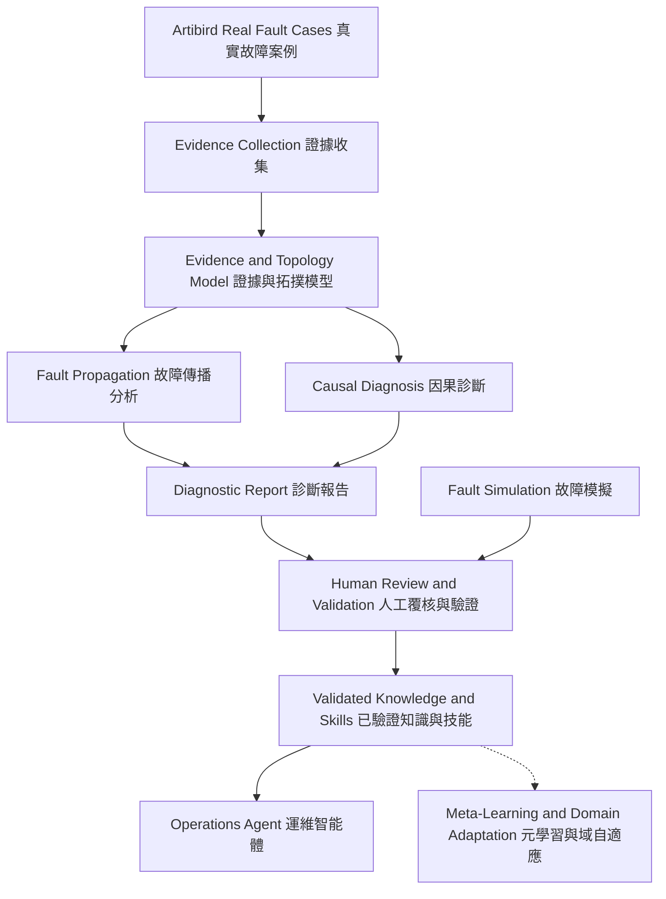
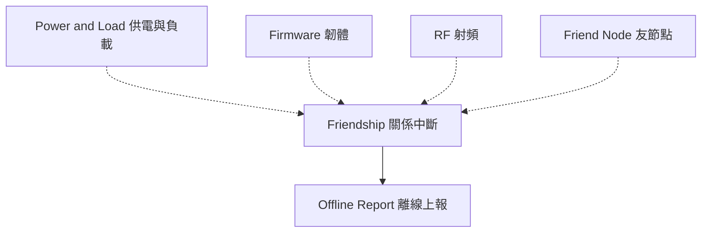
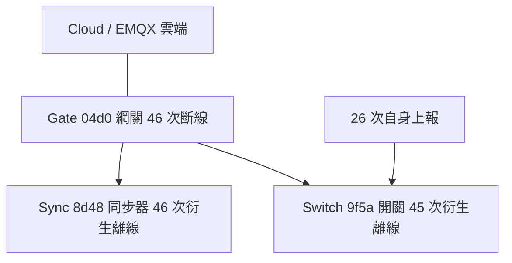

# OAI-RES-ENG-001 v0.1
# Runtime Reliability Intelligence — Engineering Specification
# OceanAI 運行可靠性智能工程規格書

> Status｜狀態：Draft for Review｜待審閱
>
> Baseline｜依據：OAI-RES-001 v0.2
>
> Engineering Owner｜工程承接：OceanAI Operations Agent
>
> Keep Running. Act as One.｜持續運行，協同如一。

## 1. Engineering Objective｜工程目標

Build an evidence-based diagnostic capability for distributed physical systems, starting with real Artibird connectivity incidents.

以 Artibird 真實連線故障為起點，建立基於證據的分散式系統故障診斷能力，使 OceanAI 能夠識別異常、定位故障、分析影響、提出根因假設及驗證方案。

首期工程必須回答四個問題：

- What happened?｜發生了什麼？
- Where did it happen?｜哪個環節出了問題？
- What was affected?｜影響了哪些設備？
- Why did it happen, and what evidence is missing?｜為什麼發生，還缺少什麼證據？

先驗證工程價值，再決定算法及開源工具。首期不要求確認所有根因，也不要求訓練模型。

## 2. System Architecture｜系統架構



純文字架構圖（可直接在任何 Markdown 編輯器閱讀）：

```text
Artibird Real Fault Cases｜真實故障案例
                    │
Evidence Collection｜證據收集
                    │
Evidence & Topology Model｜證據與拓撲模型
          ┌─────────┴─────────┐
  Fault Propagation     Causal Diagnosis
  故障傳播分析           因果診斷
          └─────────┬─────────┘
                    │
Diagnostic Report｜診斷報告
                    │
Human Review & Validation｜人工覆核與驗證
                    │ ← Fault Simulation｜故障模擬
Validated Knowledge & Skills｜已驗證知識與技能
          ├── Operations Agent｜運維智能體
          └── Meta-Learning / Domain Adaptation
              元學習／域自適應（後續研究）
```

首期以結構化證據及拓撲關係實現知識圖譜的基礎能力，不強制部署圖資料庫。Operations Agent 承接診斷結果；研究環境不直接控制 ORT、ART 或 Artibird 生產設備。

## 3. Six Research Tracks｜六個研究方向及工程落點

| Research Track｜研究方向 | Engineering Application｜工程應用 | Priority｜順序 |
|---|---|---|
| Meta-Learning｜元學習 | 利用少量已驗證案例研究新故障識別 | 後續 |
| Domain Adaptation｜域自適應 | 驗證跨設備、跨場域的診斷知識遷移 | 後續 |
| Knowledge Graph｜知識圖譜 | 關聯設備、日誌、程式碼、拓撲及人工證據 | 首期基礎 |
| Digital Twin｜數位孿生 | 先做事件重放及隔離環境故障復現，再評估孿生模型 | 第二步 |
| Fault Propagation｜故障傳播 | 識別直接事件、衍生事件與影響範圍 | 首期 |
| Causal Analysis｜因果分析 | 建立候選根因、反證及受控實驗方案 | 首期假設分析，後續實驗 |

## 4. Initial Engineering Cases｜首期工程案例

以下數據來自已提供的案例摘要，尚未獨立核對原始資料。

### CASE-001 — Single-Live Switch｜單火開關 dbfc

鴻觀寰宇／總經辦／主燈：454 次離線，中位時長 6.8 秒；437 次由 Hub 上報，17 次由網關斷線引起。11 月 18–20 日共 439 次，11 月 21 日後降至每天 2–8 次。



虛線為待驗證假設；實線為已提供的韌體上報機制，仍需以實際版本核對。

工程任務：對齊 Friend 事件、啟動紀錄、負載狀態、射頻資料及韌體版本；核對 11 月 21 日前後變更。437 次 Hub 上報不能直接視為 437 次已證實的硬體故障。

### CASE-002 — Gateway｜網關 04d0

日月光／客廳：46 次網關斷線，其中 40 次在 17–20 秒內恢復。同步器 8d48 的 46 次離線均為衍生事件；開關 9f5a 的 71 次離線中，45 次為衍生事件，26 次為自身上報。



工程任務：核對 Issue #44 的實際狀態及 EMQX 斷開原因接入能力；對齊 MQTT、Wi-Fi、重啟及重連紀錄，研究 17–20 秒是否與超時或重連設定有關。

下游離線不能直接證明設備停止工作。兩個案例的根因均維持 UNKNOWN｜未知，直至取得充分證據。

## 5. Core Modules｜核心工程模組

| Module｜模組 | Input｜輸入 | Output｜輸出 |
|---|---|---|
| Evidence Collector｜證據收集器 | 日誌、拓撲、原始碼、韌體版本 | 標準化證據及缺失清單 |
| Timeline Builder｜時間線 | 事件及時間資料 | 跨層事件時間線、時間不確定性 |
| Knowledge Model｜知識模型 | 設備、依賴、證據、假設 | 可查詢的關係與證據鏈 |
| Propagation Analyzer｜傳播分析器 | 時間線、有效拓撲、上報機制 | 直接／衍生／未知事件 |
| Root Cause Analyzer｜根因分析器 | 證據鏈、規則、程式碼 | 候選根因、支持與反對證據、驗證方案 |
| Report Generator｜報告生成器 | 分析結果 | 工程診斷報告、人工覆核清單 |

### Minimum Data Contract｜最小資料契約

| Field｜欄位 | Purpose｜用途 |
|---|---|
| event_id / evidence_ref | 事件識別、原始證據位置 |
| site_id / device_id / source | 場域、設備、上報來源 |
| event_type / reason_code | 事件類型、原因碼；缺失則標記 UNKNOWN |
| occurred_at / received_at / clock_quality | 發生時間、接收時間、時鐘可信度 |
| firmware_version / boot_id | 韌體版本及啟動識別；來源無資料時保留空值 |
| parent_id / relation_type / topology_version | 依賴節點、關係類型與有效拓撲版本 |

拓撲關係須區分上報、控制、連線與依賴。時間關聯容差應根據實際時鐘誤差及上報延遲確立，不能單憑同時發生就判定因果。

## 6. Engineering Work Packages｜工程工作包

| Task｜任務 | Required Work｜工作要求 | Deliverable｜交付 |
|---|---|---|
| WP-01 Evidence Audit｜證據盤點 | 唯讀核對兩案資料、現行 API、原始碼及日誌欄位 | EVIDENCE.md、GAPS.md |
| WP-02 Timeline & Topology｜時間線與拓撲 | 建立統一事件格式、時間線及依賴圖 | events.jsonl、topology.json |
| WP-03 Fault Propagation｜故障傳播 | 以規則及拓撲重放兩案，區分自身上報與衍生離線 | 分析程式、測試及結果 |
| WP-04 Causal Diagnosis｜因果診斷 | 核對候選原因、缺失證據及相反證據，設計受控實驗 | CASE-001.md、CASE-002.md、TEST-PLAN.md |
| WP-05 Reporting & Review｜報告與覆核 | 產出診斷報告，交工程師確認 | DIAGNOSTIC-REPORT.md、REVIEW.md |

每個工作包完成後更新其 REVIEW.md，記錄摘要、完成度、品質、未解問題、成果及下一步。生產端診斷欄位不足時，提交獨立變更提案；不自行修改線上服務或韌體。

## 7. Diagnostic Report｜診斷報告要求

每個案例必須呈現：現象、影響範圍、事件時間線、已確認事實、候選根因、支持與反對證據、未知事項、人工驗證方案及覆核結果。

| Evidence Status｜證據狀態 | Meaning｜含義 |
|---|---|
| OBSERVED｜已觀測 | 具有可追溯的原始資料 |
| INFERRED｜已推斷 | 根據已知規則及證據得到，仍需覆核 |
| HYPOTHESIS｜假設 | 合理但尚未驗證的解釋 |
| UNKNOWN｜未知 | 證據不足或相互矛盾 |
| VERIFIED｜已驗證 | 經充分證據及工程師覆核，必要時通過受控實驗 |

## 8. Acceptance Criteria｜驗收標準

| Test｜測試 | Acceptance｜通過條件 |
|---|---|
| Evidence Traceability｜證據追溯 | 每項已確認結論均能定位原始證據；摘要不得冒充原始日誌 |
| Case Replay｜案例重放 | 原始資料齊備後，核對兩案統計及 91 次已報告的下游衍生離線；差異須解釋，不得硬編碼結果 |
| Independent Events｜自身事件 | 保留 9f5a 的 26 次自身上報作為獨立待分析事件，不預設其根因 |
| Negative Tests｜反例測試 | 同時離線但無依賴關係、拓撲變更、重複事件、時鐘偏差及缺失事件均有測試；不得誤判為已確認傳播 |
| Unknown Handling｜未知處理 | 缺少關鍵證據時輸出 UNKNOWN，明列補證需求 |
| Operational State｜運行狀態 | 通訊中斷不得直接映射為物理設備停止工作 |
| Safety｜安全 | 生產資料唯讀；無未授權寫入、設備命令或自動恢復操作 |

若原始資料無法取得，案例重放驗收標記 BLOCKED｜受阻；合成測試須明確標識，不能當成真實案例已驗證。

## 9. Implementation Roadmap｜實施順序

| Phase｜階段 | Scope｜範圍 |
|---|---|
| 1 Evidence & Baseline｜證據與基準 | 完成 WP-01 至 WP-05，先做唯讀診斷與報告 |
| 2 Knowledge & Skills｜知識與技能 | 將已覆核案例轉為知識關係及版本化 Skills，通過回歸測試 |
| 3 Causality & Simulation｜因果與模擬 | 隔離環境事件重放、故障注入及受控實驗 |
| 4 Learning & Prediction｜學習與預測 | 比較圖神經網路、元學習及域自適應與簡單基準的效果 |
| 5 Runtime Integration｜運行整合 | 成熟成果經審查接入 Operations Agent，必要時接入 ORT／ART |

此研究路線不改變 Operations Agent MVP Phase 1 日誌診斷、Phase 2 Skill 演進的既有順序。算法及開源框架只有在工程價值、準確性、成本及可維護性得到比較驗證後才選定。

## 10. Codex Handoff｜Codex 執行指令

**Task ID: OAI-RES-TASK-001 — Evidence-Based Connectivity Fault Diagnosis｜基於證據的連線故障診斷**

1. Inspect the existing repositories and available evidence in read-only mode. Identify reusable modules before proposing new components.  
   唯讀檢查現有儲存庫及證據，先找出可重用模組，再提出新增元件。
2. Complete WP-01 first. Record missing access, data fields and source versions in GAPS.md.  
   先完成 WP-01，將缺失權限、資料欄位及來源版本記錄於 GAPS.md。
3. Implement and test the baseline diagnostic workflow in an approved isolated development environment.  
   在獲准的隔離開發環境中實作並測試基準診斷流程。
4. Produce case reports with evidence references, alternative hypotheses and validation plans. Never fabricate missing data or confirmed causes.  
   產出附證據引用、替代假設及驗證方案的案例報告，不得捏造缺失資料或已確認根因。
5. Deliver a REVIEW.md for each work package. Do not deploy, modify production firmware, execute recovery actions or select a final ML framework without review.  
   每個工作包交付 REVIEW.md；未經審查不得部署、修改生產韌體、執行恢復或鎖定機器學習框架。

首個交付是 WP-01 證據盤點，不要求新建儲存庫或改動現有生產架構。實際儲存庫位置、API、資料權限及負責人由工程團隊確認。

---

**Engineering principle｜工程原則**

Every diagnosis must be traceable, every causal claim must be testable, and every reusable skill must be validated.

每項診斷均可追溯，每項因果主張均可驗證，每項可重用技能均經過驗證。
